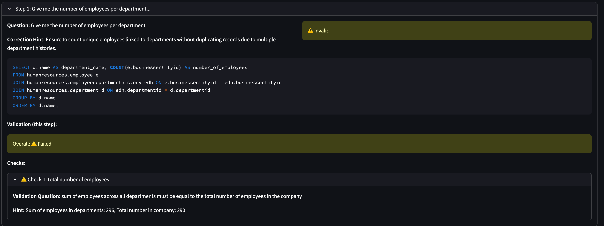
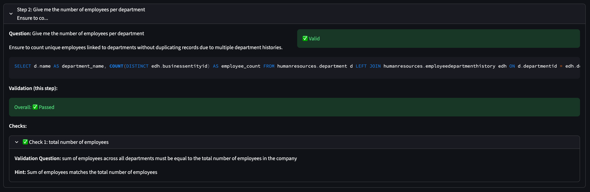

# When the SQL runs but the answer is wrong

> A small experiment in checking difficult data questions with simpler ones.

## 1. It runs. Great. Is it right? 🤔

I started this experiment in late 2024 and worked on it through mid-2025. A little late to the sharing party, then. 

But I still like the question behind it: **can we check an analytical answer through smaller, easier questions?**

Natural-language SQL tools let people explore data without writing queries. Which is lovely. **Until the query works perfectly and answers something slightly different**.

There are two rather different problems here:

- **SQL errors fail loudly.** The database returns an error. An agent can use it to attempt a repair.
- **Semantic errors look like success.** The query runs, but uses the wrong filter, population, join, or level of detail. The numbers look plausible. Everyone move on. _Oops_.

The second case is harder to spot if you do not know the data well.

My small idea: generate a **check question** alongside the main question, plus a **validation rule** describing how their answers should relate. 

> Something simpler that gives us a reason to doubt the first answer.

The workflow goes like this:

1. **Generate and execute the main SQL query**. Attempt repairs if execution fails. Stop if the agent considers the question unanswerable.
2. **Generate a few smaller check questions**, turn them into SQL, and execute them.
3. **Generate checks comparing the main and supporting results**.
4. **If a check fails, append a correction hint to the original question** and try again.

The loop generates a new query and new results, it does not patch the returned numbers. 

In my implementation, [Pydantic AI](https://pydantic.dev/docs/ai/overview/) handles the model calls, PostgreSQL provides the data, and Streamlit makes the attempts visible. 

You can check [codebase overview](codebase-overview.md) for the module map.

## 2. Six mystery employees walk into a join 🚶

Take this question: **“_How many employees are there per department?_”**

A smaller check is: **_“How many employees are there in total?_”**.

The department counts should add up to that total—assuming we mean current employees, each assigned to one department. The result should also contain an actual department breakdown.

In this recorded [AdventureWorks](https://github.com/microsoft/sql-server-samples/tree/master/samples/databases/adventure-works) run, the first query includes department history. Its department counts add up to **296**, while the separately queried employee total is **290**. Six extra employees. Very efficient recruitment 👏

**The failed check produces a hint about avoiding duplicate counts from department histories.** The hint is appended to the question, and the next attempt passes the check.

That is the interesting bit: **❔ question → ❓ check → 🛑 contradiction → 💡 hint → ✅ retry**. 

These screenshots show an earlier interface. Results and generated checks may vary between runs. To try it yourself, see [run-me.md](run-me.md).

## 3. Worth checking. Still worth questioning 🧐

I kept this experiment simple to make one idea easy to inspect: **break a difficult answer into smaller properties we can check, then use failures to guide another attempt.** These are illustrative runs, not an accuracy benchmark.

A passed check is still only evidence. Generated checks can be wrong, or share the main query’s misunderstanding. Better business context and trusted references matter too. 

Sometimes the most useful next step is simply to ask the user what they meant.

For a practical look at that broader work: 
- Databricks describes how business context and benchmarks help [build trust in Genie’s answers](https://www.databricks.com/blog/how-build-production-ready-genie-spaces-and-build-trust-along-way).
- Anthropic’s [Demystifying evals for AI agents](https://www.anthropic.com/research/demystifying-evals-for-ai-agents) explores how to define success and measure what an agent actually accomplished.
- [TS-SQL](https://aclanthology.org/2025.findings-emnlp.156/) explores a similar idea that uses generated tests to improve SQL answers. It checks against expected answers on test data while my experiment checks consistency through simpler, related questions.

**And for a detour into clarifying intent before implementation, there is [my post on the Pre-Code Interview](https://substack.com/home/post/p-210582916)**. Tiny self-promotion break 😉

> 👉 **_Better generation reduces mistakes. Better checking helps us notice the mistakes that remain._**
